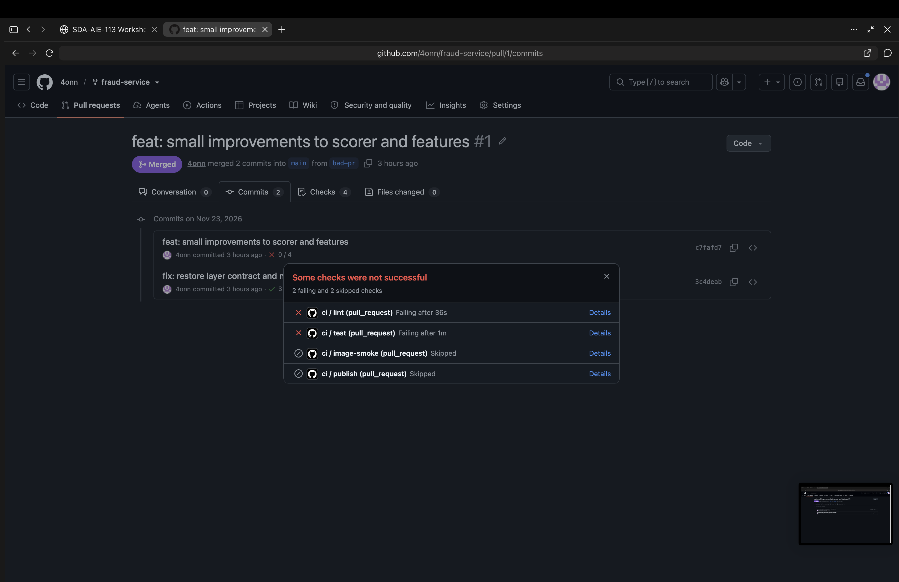
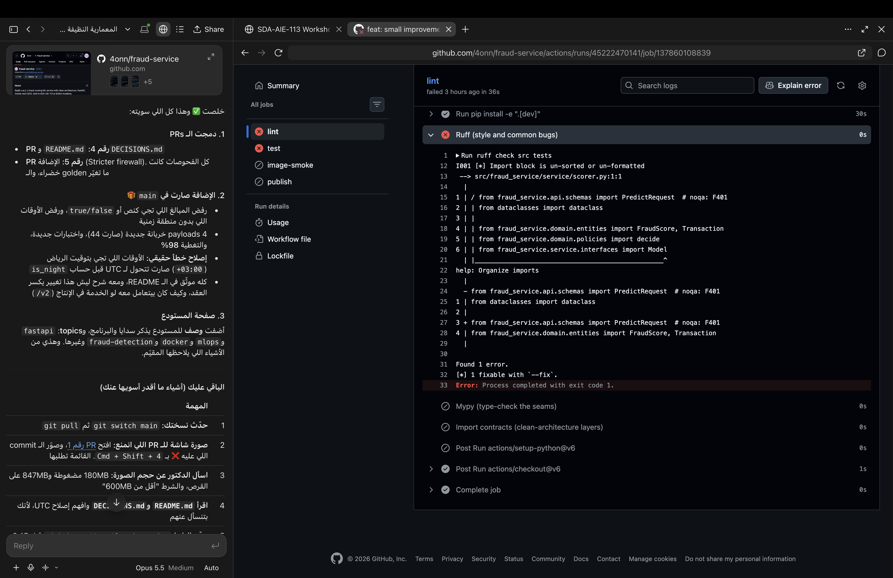
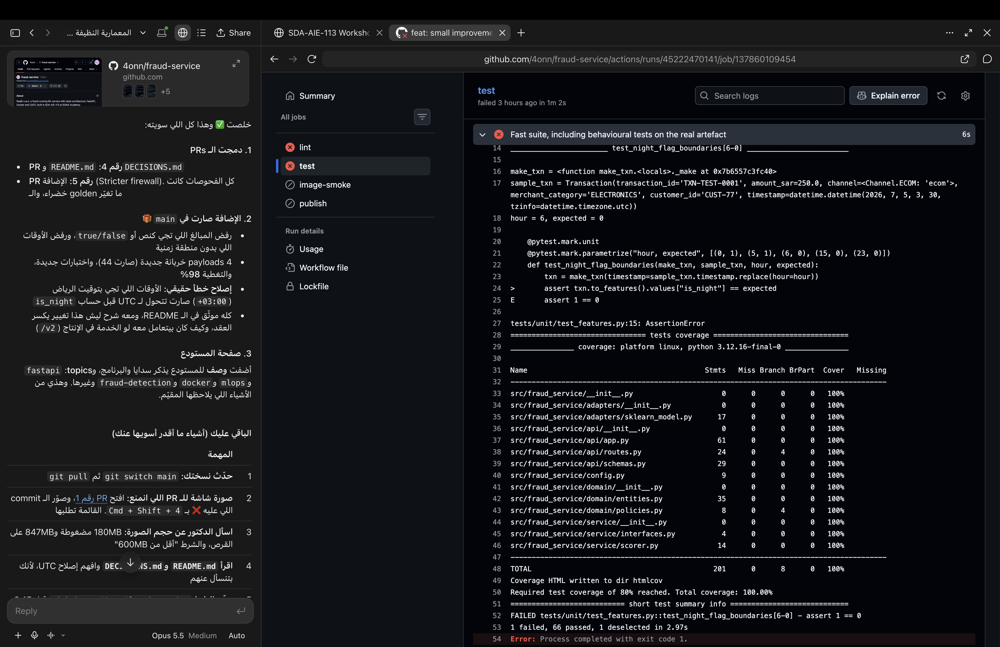

# Raqib (رقيب) · fraud-scoring service

A containerised machine-learning service that scores card transactions for fraud risk
and answers **allow**, **review** or **block**.

Built in the training program **SDA-AIE-113 · Software Engineering Practices for AI Systems**
at [SDAIA Academy](https://github.com/SDAIAAcademy), November 2026,
through SDAIA's [Athka X](https://athkax.sdaia.gov.sa) platform (أذكى إكس).


## Team

| | Name | GitHub |
|---|---|---|
|  | Nawaf Alzomaia · نواف الزميع | [@4onn](https://github.com/4onn) |
|  | Abdullah Alwohibi · عبدالله الوهيبي | [@wahibi404](https://github.com/wahibi404) |
|  | Hamad Alkeaid · حمد الكعيد | [@HamadAlkeaid](https://github.com/HamadAlkeaid) |

## What it does

A Saudi digital-payments provider needs every card transaction scored for fraud before it is
approved. Client systems (mobile app, core banking, partner integrations) send one transaction
to `POST /v1/predict`; the service returns a fraud probability between 0 and 1 and a decision:

| Probability | Decision |
|---|---|
| ≥ 0.85 (configurable) | `block` |
| 0.70 to 0.85 | `review` (manual review band) |
| < 0.70 | `allow` |

The model is a scikit-learn gradient-boosting pipeline (`fraud_xgb v3.2.0`).
**All data in this repository is synthetic.** No real customer data is used.

## Architecture

```
src/fraud_service/
├── domain/     entities.py (Transaction, to_features), policies.py (decide)   stdlib + pydantic only
├── service/    interfaces.py (Model protocol), scorer.py (FraudScorer)       no frameworks
├── adapters/   sklearn_model.py   the ONLY file that imports joblib / pandas / scikit-learn
├── api/        app.py, routes.py, schemas.py   FastAPI, the composition root
├── batch.py    batch entrypoint (CSV in, CSV out)
├── config.py   typed settings, validated at start-up
└── logging_setup.py   JSON logs to stdout, secret masking
```

Imports point inward only: `api → adapters → service → domain`. The rule is enforced by
`import-linter` (`lint-imports`) in the pipeline, so a violation fails the build.
The service depends on a `Model` protocol rather than on scikit-learn, so the model can be
swapped (ONNX, a remote model server) by adding one adapter, and tests run with a fake model.

## Run it

### With Docker (recommended)

    docker compose up --build -d
    docker compose ps                      # wait until fraud-api shows (healthy)
    curl -s localhost:8000/v1/ready
    curl -s localhost:8000/v1/predict -H "content-type: application/json" -d @payloads/sample.json

    # -> {"fraud_probability":0.62614,"decision":"allow","model_version":"v3.2.0",...}
    docker compose down

Or pull the published image:

    docker pull ghcr.io/4onn/fraud-service:main      # Apple silicon: add --platform linux/amd64

### Without Docker (Python 3.12+)

    python -m venv .venv && source .venv/bin/activate
    pip install -e ".[dev]"
    echo "FRAUD_MODEL_PATH=models/fraud_xgb_v3.joblib" > .env
    uvicorn fraud_service.api.app:create_app --factory

### Batch scoring

    python -m fraud_service.batch                    # data/transactions_sample.csv -> scored.csv
    python scripts/check_golden.py scored.csv        # 5,000/5,000 rows match the golden scores

## API

| Endpoint | Purpose |
|---|---|
| `POST /v1/predict` | Score one transaction |
| `GET /v1/health` | Liveness: the process is up (no I/O) |
| `GET /v1/ready` | Readiness: the model is loaded; `503` with `Retry-After` until then |

Interactive documentation: http://localhost:8000/docs

The request schema is strict (`extra="forbid"`, `amount_sar > 0` and a JSON number, known `channel`
values, a timestamp with a timezone), so a bad body is rejected before it reaches the model. Every response carries `X-Trace-Id`,
`X-Model-Version` and `X-Response-Time-Ms`.

Every error uses one envelope and never echoes the rejected input or a stack trace:

    {"error": {"code": "INVALID_REQUEST", "message": "Request body failed validation",
               "trace_id": "5048862c21904f3e", "details": [{"field": "amount_sar", "problem": "..."}]}}

| Code | Status | When |
|---|---|---|
| `INVALID_REQUEST` | 422 | The body fails the schema |
| `NOT_FOUND` | 404 | Unknown path |
| `MODEL_UNAVAILABLE` | 503 | The model is not loaded yet (`Retry-After` header) |
| `HTTP_ERROR` | other 4xx/5xx | Any other HTTP error |
| `INTERNAL_ERROR` | 500 | Unexpected failure; details are only in the server log, under the same `trace_id` |

## Configuration

All settings live in one typed class (`config.py`) and are read from environment variables
with the `FRAUD_` prefix (or a local `.env` file). A missing or invalid value stops the service
at start-up with a clear message.

| Variable | Default | Meaning |
|---|---|---|
| `FRAUD_MODEL_PATH` | required | Path to the model bundle; the file must exist |
| `FRAUD_BLOCK_THRESHOLD` | 0.85 | Scores at or above this are blocked (0.5 to 0.99) |
| `FRAUD_LOG_LEVEL` | INFO | DEBUG, INFO, WARNING or ERROR |
| `FRAUD_GIT_SHA` | dev | Injected at build time; shown by `/v1/health` |
| `FRAUD_REDIS_URL` | redis://localhost:6379/0 | Feature cache |
| `FRAUD_REGISTRY_TOKEN` | none | Secret; only from the platform's secret store |

Secrets are never committed. `configs/settings.example.env` documents every setting without
real values; `.env` is git-ignored and excluded from the image by `.dockerignore`.
Logs are JSON on stdout, in UTC, with `trace_id` and `model_version`; sensitive keys are masked
and no personal data is logged. See [INCIDENT.md](INCIDENT.md) for the secret-leak runbook.

### Secrets, layer by layer

| Where a secret could leak | What stops it |
|---|---|
| A local commit | `pre-commit` runs gitleaks before every commit (`pre-commit install` once) |
| A pull request or `main` | The `secrets-scan` job (gitleaks, action pinned to a commit SHA) is a required check |
| A push to GitHub | GitHub secret scanning and push protection are enabled on the repository |
| The image | `.dockerignore` excludes `.env` and `*.env`; settings arrive as environment variables at run time |
| The logs | Sensitive keys (`token`, `password`, `secret`...) are replaced by `***MASKED***` |
| The settings object | `registry_token` is a `SecretStr`: printing the settings shows `**********` |
| CI credentials | Only GitHub's short-lived `GITHUB_TOKEN`; `packages: write` is granted to the `publish` job alone |

Next step if the service gets real secrets: SOPS with age to keep them encrypted in the repository,
and OIDC instead of stored cloud keys for deployment.

## Tests

    pytest -m "not slow"        # every commit: unit, integration, behavioural and data checks, coverage gate 80%
    pytest                      # everything, including the golden-file test (~9 s)

| Level | What it checks |
|---|---|
| Unit (27) | Decision bands at their exact boundaries, feature logic (night flag at hour 6, UTC normalisation), scorer wiring with a fake model, typed settings, the strict wire contract |
| Integration (50) | The HTTP contract through `TestClient`; all 44 bodies in `payloads/malformed/` are rejected; readiness and error envelope |
| Data (9) | The data files themselves: expected columns, no missing values, unique IDs, amounts inside the API contract, known channels, timezone on every timestamp, golden file aligned with the transactions |
| Behavioural | Against the real model: the score does not change with merchant casing or IDs (invariance); a much larger amount never looks safer (direction); all 5,000 golden scores reproduce |

## Pipeline

`.github/workflows/ci.yml` runs on every pull request and on `main`:

1. `lint` (ruff, mypy, import contract), `test` (fast suite + coverage) and `secrets-scan` (gitleaks) in parallel
2. `image-smoke`: builds the image, starts it, waits for readiness, sends a real request,
   checks the container runs as `appuser`
3. `publish` (only on `main`): pushes to `ghcr.io/4onn/fraud-service`, tagged with the
   commit SHA and `main`

`nightly.yml` runs the full suite, including the golden-file test, every night.
`main` is protected: changes arrive only through pull requests with `lint`, `test`,
`secrets-scan` and `image-smoke` green. [Pull request #1](https://github.com/4onn/fraud-service/pull/1) shows a
change that was blocked (a layer violation and the `hour <= 6` bug) and then fixed.



| `lint` caught the layer violation | `test` caught the night-flag bug |
|---|---|
|  |  |

## Extension: stricter firewall

By default pydantic is lenient: it turned `"amount_sar": "250"` into `250.0`, `true` into `1.0`,
and accepted `"2026-07-05T03:30:00"` with no timezone. For a fraud service each of these is a
silent guess, so the contract now rejects them with `422 INVALID_REQUEST`:

| Input | Before | Now |
|---|---|---|
| `"amount_sar": "249.99"` (string) | coerced to 249.99 | rejected (`strict=True`) |
| `"amount_sar": true` (boolean) | coerced to 1.0 | rejected (`strict=True`) |
| `"timestamp": "2026-07-05T03:30:00"` (no timezone) | accepted as naive | rejected (`AwareDatetime`) |
| `"timestamp": "2026-07-05"` (date only) | accepted as midnight | rejected (`AwareDatetime`) |
| `"amount_sar": 250` (integer number) | accepted | still accepted |
| `"timestamp": "2026-07-05T06:30:00+03:00"` | hour read as 06 | accepted, normalised to 03:30 UTC |

The last row is a skew fix found while writing the tests: the model was trained on UTC hours,
but a client in Riyadh sending `+03:00` would have had `hour_of_day` and `is_night` computed
in local time. `to_features()` now converts to UTC first; naive timestamps (batch CSV) are
treated as UTC, so the golden file still reproduces 5,000/5,000.

Covered by four new bodies in `payloads/malformed/` and `tests/unit/test_schemas.py`.

**Contract change note.** Tightening a field is a breaking change for any client that relied on
the coercion. It stays in `/v1` because the service has no production consumers yet. After
launch, the same change would ship as `/v2`, run side by side with `/v1`, and `/v1` would be
retired with `Deprecation` and `Sunset` headers once its traffic reaches zero.

## Model, journal, benchmarks and decisions

- [MODEL_CARD.md](MODEL_CARD.md): what goes in, what comes out, how good the model is (AUC 0.857) and where it fails.
- [JOURNAL.md](JOURNAL.md): one entry per stage: what we asked, what was built, what we checked.

See [BENCHMARKS.md](BENCHMARKS.md) (image sizes, build times, latency, memory, CI timings)
and [DECISIONS.md](DECISIONS.md) (five engineering decisions and the reasons behind them).
